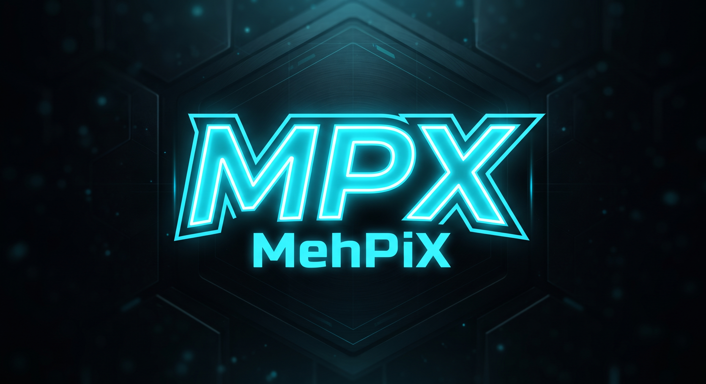

# PyAI



[MehPiX](https://mehpix.github.io)'in ilk projesi. Tek dosyayla açılan bir sohbet botu:
kurulum gerektirmez, sohbetleriniz ve PyAI'ın öğrendikleri yalnızca kendi bilgisayarınızda
saklanır.

**Proje sayfası:** https://mehpix.github.io/projeler/pyai

## İndirme

[**PyAI.exe'yi indir**](https://github.com/mehpix/PyAI/releases/latest/download/PyAI.exe)
(yaklaşık 9 MB) — tüm sürümler: [Releases](https://github.com/mehpix/PyAI/releases)

| | |
|---|---|
| Sistem | Windows 10 veya 11 (64 bit) |
| Kurulum | Gerekmez; dosyayı çalıştırmanız yeterli |
| Sohbetler | Programın yanındaki `sohbetler` klasörüne kaydedilir |

## İlk açılışta Windows uyarısı

PyAI dijital olarak imzalanmadığı için Windows ilk açılışta **"Windows bilgisayarınızı korudu"**
(SmartScreen) uyarısı gösterebilir. Bu, imzasız ve henüz az indirilmiş programlarda görülen
genel bir uyarıdır. Çalıştırmak için **Ek bilgi → Yine de çalıştır**'a tıklayın.

Dosyanın bizim yayınladığımız dosyayla aynı olduğunu doğrulamak için PowerShell'de:

```powershell
Get-FileHash .\PyAI.exe -Algorithm SHA256
```

Çıkan değer, ilgili sürümün [Releases](https://github.com/mehpix/PyAI/releases) sayfasında
yazan SHA-256 değeriyle aynı olmalıdır.

## Lisans

© 2026 MehPiX. Tüm hakları saklıdır. PyAI ücretsiz olarak indirilip kullanılabilir.

---

**English:** PyAI is a chatbot for Windows 10/11 (64-bit) that runs from a single file with no
installation; chats are stored on your own computer. Download it from
[Releases](https://github.com/mehpix/PyAI/releases/latest). Windows SmartScreen may warn on
first launch because the file is not code-signed: choose *More info → Run anyway*.
